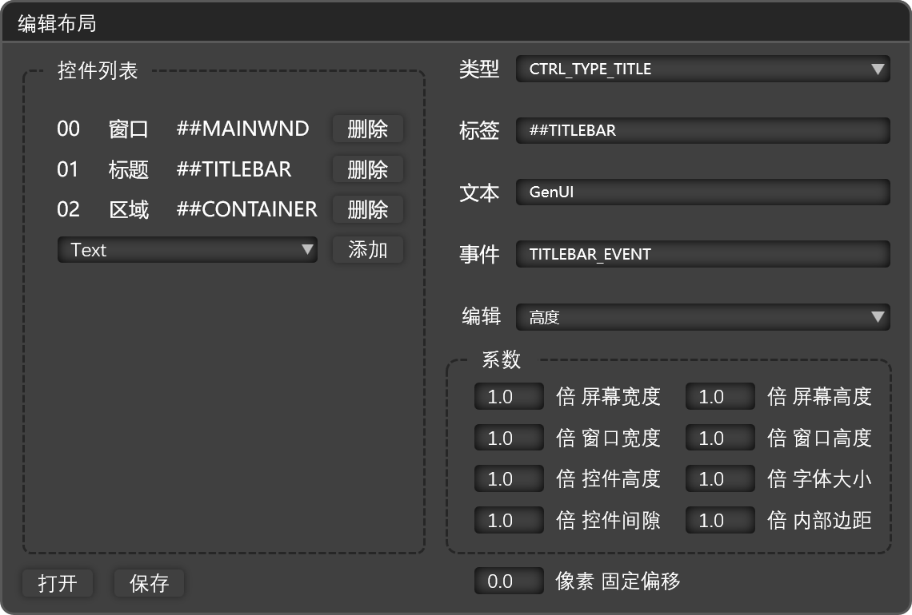
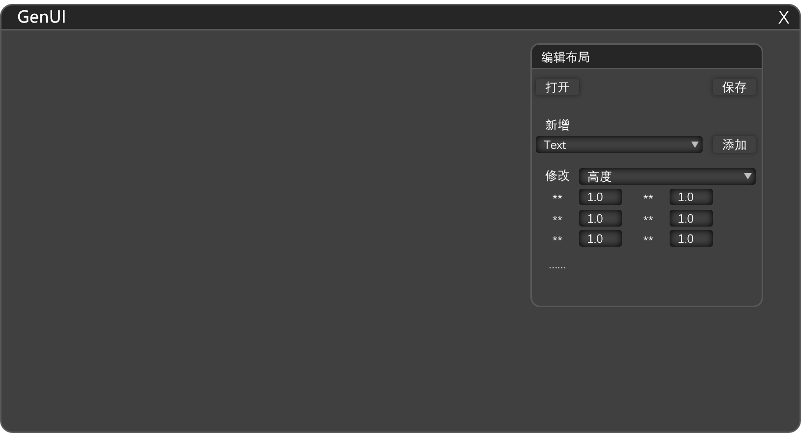

# GenUI

基于 [Dear ImGui](https://github.com/ocornut/imgui) 封装的声明式 UI 框架，以及一个用它自己设计界面的 UI 设计器。

界面由布局文档（JSON 或 bin）唯一描述；设计器负责增删控件、调整几何、打开与保存文档，预览窗口实时呈现被编辑的布局。设计器自身的界面同样是一份 GenUI 布局（"可自举"）。





## 特性

- **声明式布局**：所有 UI 元素都在布局文档中声明，文档是唯一真源；代码里没有硬编码的界面。
- **几何量全部相对化**：控件位置与尺寸由系数（相对窗体宽高、控件高、字号、间隔、内边距）加像素偏移表达，随参考尺寸整体缩放。
- **双格式文档**：JSON 便于阅读与版本管理；bin 为定长记录 + CRC32 校验的紧凑格式，解析不依赖 JSON 库。两种格式用同一套模型，读方向按文件内容嗅探，写方向按目标扩展名分派。
- **数据经控件缓冲交互**：`ctrl.buffer` 承载控件状态，渲染是缓冲的函数；事件只经回调函数执行。
- **父子链**：`parent` 字段同时驱动层序推导与坐标累加；`CTRL_EVENT_ENTRUST_PARENT` 把子控件的事件委托给父容器。
- **可自举**：编辑器窗口由保留名布局 `GenUIEditor` 驱动，无需为设计器另写一套界面代码。
- **自包含运行时**：静态链接（`/MT`），只依赖系统自带的 D3D11 / DXGI / DWM。

## 设计原则

1. 布局 = 具有独立属性的界面（默认一个布局对应一个窗口的状态，但不是定义）。
2. 声明式布局：布局文件是唯一真源。
3. 数据经 `ctrl.buffer` 交互；`controls` 库按 `ctrl.type` 视为不同结构解析（类型 → 缓冲 → 渲染 = f(缓冲) → 事件）。
4. 事件经回调函数执行：布局声明 `event` 名，绑定表映射到处理函数。

框架层（`src/framework`）不包含编辑器或应用语义，可整体迁移到其它项目复用；设计器相关的文档层、编辑器层、宿主层分别位于 `src/doc`、`src/editor`、`src/app`。

## 构建

### 前置

| 项 | 要求 |
| :--- | :--- |
| 系统 | Windows 10 / 11 x64 |
| 工具链 | Visual Studio 2026（"使用 C++ 的桌面开发"工作负载），CMake 3.28+ |
| Python | Python 3（构建期把工程源 JSON 转成 bin，并投放/内嵌；缺失时只告警并退化为仅 JSON） |
| 依赖 | 仓库自带 `nuget\GenUI.Deps.Native.1.0.0.nupkg`（ImGui 1.92.x + DX11/Win32 后端、rapidjson 的头与库），无需联网 |

### 步骤

以下命令在仓库根目录执行（Visual Studio 开发者命令行或已加入 PATH 的终端）：

```powershell
# 1. 生成解决方案
cmake -S . -B out -G "Visual Studio 18 2026" -A x64

# 2. 向生成的工程注入本地 NuGet 依赖（每次 configure 后都要重跑）
pwsh -File tools\inject-nuget.ps1
#    没有 PowerShell 7 时，手工在 out\GenUI.vcxproj 的 </Project> 之前插入：
#    <ItemGroup><PackageReference Include="GenUI.Deps.Native"><Version>1.0.0</Version></PackageReference></ItemGroup>

# 3. 还原并构建（Release / Debug 任选）
msbuild out\GenUI.slnx -t:Restore -p:Configuration=Release -p:Platform=x64
msbuild out\GenUI.slnx -p:Configuration=Release -p:Platform=x64 -m
```

若使用 Visual Studio 2022，把生成器名改为 `"Visual Studio 17 2022"` 即可；工程本身只要求 C++20。

### 产物

```
out\Release\
├─ GenUI.exe      主程序（内置 bin / JSON 兜底资源）
└─ GenUI.bin      构建期生成的 bin 文档（加载链第 1 级）
```

`GenUI.json` 是工程源（只读输入），`tools\json2bin.py` 在构建期由它生成 `GenUI.bin`；同一份 bin 也作为第 3 级内嵌资源编入 exe。找不到 Python 时退化为只复制 JSON。

## 运行

工作目录必须是 exe 所在目录（布局文档按 exe 同目录解释）：

```powershell
cd out\Release
.\GenUI.exe
```

加载链依次为：

1. `.\GenUI.bin`（exe 目录外部文件）
2. `.\GenUI.json`（exe 目录外部文件）
3. 内嵌资源 `resource.res\GenUI.bin`
4. 内嵌资源 `resource.res\GenUI.json`

命中即用，不再探测后续级别；形态由内容嗅探判定，与扩展名无关。

| 环境变量 | 作用 |
| :--- | :--- |
| `GENUI_AUTOCLOSE_MS` | 启动后 N 毫秒自动退出（无人值守运行用）；不设则常驻 |

退出：`ESC` 或 `Alt+F4`；有未保存改动时先弹出同步提示。

## 布局文档

文档是一个 `layouts` 数组，每项是一份布局；控件记录带类型、标签、文本、事件与四轴系数：

```json
{
  "layouts": [
    {
      "name": "DemoMain",
      "label": "GenUI Demo",
      "autosize": {
        "mode": "AUTO_SIZE_BY_SCREEN_HEIGHT",
        "width": 570, "height": 500,
        "controlHeight": 25, "fontSize": 13, "space": 10, "padding": 4
      },
      "ctrls": [
        {
          "id": 0, "parent": -1,
          "type": "CTRL_TYPE_WND", "label": "GenUI Demo",
          "text": "", "event": "",
          "x": { "coeff": [0,0,0,0,0,0,0,0], "offset": 180 },
          "y": { "coeff": [0,0,0,0,0,0,0,0], "offset": 120 },
          "width": { "coeff": [0,0,1,0,0,0,0,0], "offset": 0 },
          "height": { "coeff": [0,0,0,1,0,0,0,0], "offset": 0 }
        }
      ]
    }
  ]
}
```

系数依次作用于：窗体宽、窗体高、控件高、字号、间隔、内边距（第六项备用），再加 `offset` 像素。结构件 `WND` / `TITLE` / `CNTR` 描述窗口、标题栏与内容容器；内容控件的类型见 `src\framework\base\ControlSpec.h` 的类型表（21 种类型）。

bin 格式为定长记录：12 字节文件头（CRC32 + 版本 + 段数）、每布局 4 字节段头 + 376 字节头部区 + 536 字节/控件；版本号低 8 位为格式标记。

## 目录结构

```
GenUI\
├─ src\
│  ├─ main.cpp                 进程入口（只调用宿主）
│  ├─ app\                     应用层：双窗口宿主 AppHost、应用主类 Application、宿主上下文、文档 I/O 与会话
│  ├─ doc\                     文档领域层：文档承载者与结构一致性校验
│  ├─ editor\                  编辑器层：编辑器外壳逻辑、编辑命令、写方向（LayoutWriter）、选中态叠加件
│  ├─ framework\               框架层（可迁移复用，不含编辑器语义）
│  │  ├─ base\                 基础设计量、控件类型契约、控件缓冲、文本宽度、平台环境件（AppEnv）
│  │  ├─ base\mem\             内存设施：MemoryManager 分配器与 AllocatorHub 会话分配器
│  │  ├─ base\util\            纯算法件：FileCodec（CRC32）
│  │  ├─ render\               渲染能力表 + ImGui 实现（宿主 / D3D11 / 控件库 / 部件层）
│  │  ├─ layout\               布局对象、中间态、构建原语、读方向解析、渲染出口、几何解算
│  │  └─ dispatch\             帧间事件、事件绑定表、调度层、资源与路径解析（ResourceLoader）
│  └─ **\*.md                  每个源文件模块一份接口文档
├─ cmake\                      内置文档资源脚本（第 3/4 级）
├─ tools\                      json2bin.py（构建期 bin 生成）、inject-nuget.ps1
├─ GenUI.json                  工程源（只读输入；运行时数据）
├─ vcpkg.json                  vcpkg manifest（imgui / rapidjson 的可选依赖声明）
├─ NuGet.config                本地离线包源
├─ docs\                       文档体例
├─ bench\                      内存管理基准与契约测试（独立 CMake 工程，不参与主产物）
└─ out\                        构建产物
```

## 文档

- **接口文档**：每个源文件模块一份 `.md`，与源码同目录，只写当前接口、契约与用法。
- **体例**：`docs\INTERFACE-DOC-STYLE.md`。

## 已知限制

- 仅支持 Windows x64 与 D3D11；未启用 ImGui viewports（预览窗口是真实的被编辑文档窗口，与 viewports 语义冲突）。
- 交互观感（拖动、悬停、输入法）需在本机人工复核；无人值守下只做启动与渲染链路校验。
- `bench` 为独立工程，需单独配置构建。
